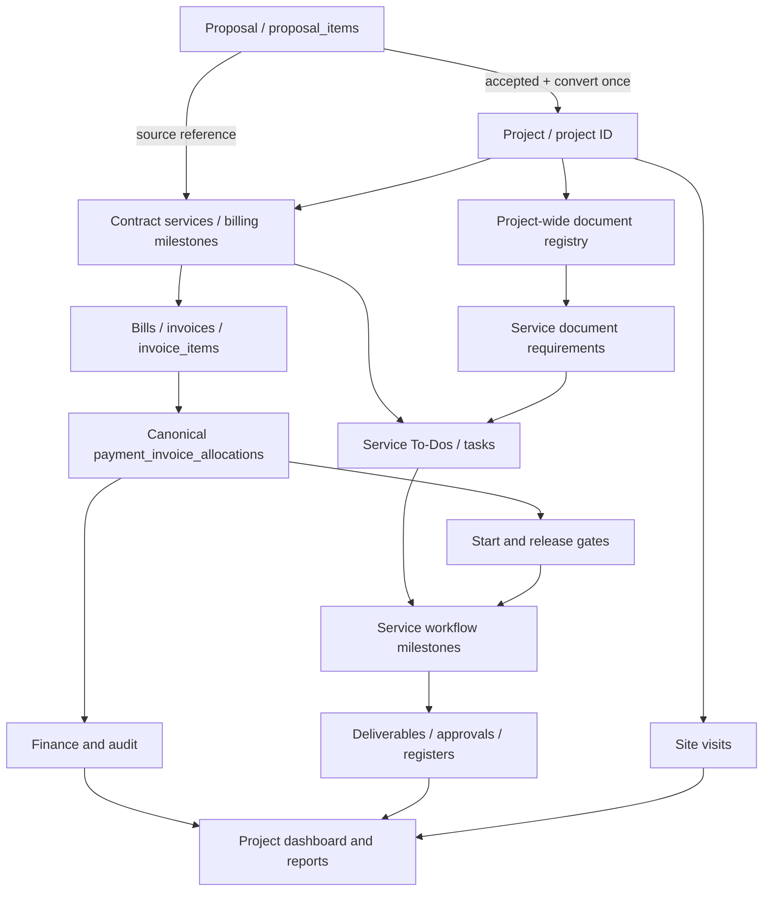

# LAND VIEW v4.0 — Unified Project Architecture (design specification)

**Status:** Proposed; no production migration or application cutover authorized by this document.
**Safety objective:** Deliver one cohesive project workspace without modifying historical financial facts, deleting records, or interrupting existing operations.
**Scope:** Proposal, project identity, bills, payment allocations, project documents, To-Do, workflow, delivery, registers, finance, site visits, notifications, audit, and role-based access.

## 1. System model: one project, linked records

The project is the primary navigation context, not a duplication of data. Preserve all source IDs and links to the original proposal. All project modules must read authoritative records; avoid a second spreadsheet, bill ledger, or workflow status store.

## 2. Existing production contracts to preserve

- **Identity and project:** `projects`, `clients`, `proposals`, `proposal_items`, `prospective_clients`.
- **Contract and billing:** `project_contracts`, `project_contract_services`, `billing_milestones`, `bills`, `invoices`, `invoice_items`.
- **Cash and allocation authority:** `payments`, `payment_invoice_allocations`, `payment_service_allocations`, `payment_receipts`, billing adjustments/write-offs and existing reconciliation authority. Retain historical exceptions rather than synthesizing new debt.
- **Work:** `project_service_workflows`, `todo_items`, `tasks`, service task templates, approval and dependency records.
- **Documents:** `client_document_register` (receiving/return history), `documents` (project/deliverable metadata), `project_service_documents` (service deliverables), and their current APIs.
- **Operational:** `site_visits`, `project_management_ledger`, `app_audit_log`, WhatsApp outboxes and role permissions.

**Compatibility contract:** Existing project, proposal, invoice, PDF, receipt, Client Portal, Workflow, To-Do, register and finance URLs keep working. v4 adds a unified composition layer and preserves legacy adapters during rollout.

## 3. Proposal → Project lifecycle

**Proposal entry** stores client details, site/location, building attributes, proposed services, itemized prices, discounts, and accepted terms.

**Conversion** must:
1. Validate acceptance status, pricing and item identity; reject ambiguous or partially converted states with actionable errors.
2. Reserve a unique permanent project code in one atomic database transaction. Do not rely solely on client-side max-number selection.
3. Create or link one project and its commercial contract while preserving the proposal's original information.
4. Create/link one bill per billable proposal item using stable proposal-item identity; retain draft versus issued semantics (zero-value items must not silently become issued receivables).
5. Link generated services and To-Dos; initialize the project-wide **requirements view**, not duplicate physical documents.
6. Mark proposal conversion completed only after the underlying records are consistent; retries must return the same project, not insert duplicates.

**Historical conversion:** Do not rerun conversion on past projects. Reconciliation is read-only first; exceptions require explicit review and a separately authorized repair.

## 4. Service work and payment gates

| Event / service type | Engineering and design | Other services, approvals, fees |
|---|---|---|
| Proposal item only | No project To-Do until conversion/appropriate issue | Same |
| Service bill **issued** | Create a To-Do; start work allowed | Create a To-Do; action is waiting for payment |
| Documents outstanding | Display collection tasks; block only a specific dependent action | Same |
| Partial payment | Work continues, delivery remains locked unless an explicitly approved gate says otherwise | Action stays locked unless the approved gate says otherwise |
| Full effective payment | Delivery gate may unlock, subject to verified work and document requirements | Service action may begin once required documents and permissions are ready |
| Staff completes task | Request verification; do not infer payment | Request verification; do not infer payment |
| Approved deliverable / official outcome | Record version, release, receipt, custody | Record submission, query, approval, delivery and receipts |

**Guardrails:** Payment is a financial event, not proof of work completion or municipal approval. Work status is not proof of payment. Billing controls must rely on canonical effective allocations and approved adjustments, not an invoice display label. A manager override must carry actor, timestamp, reason and affected service; never silently rewrite payment records.

## 5. Project-wide document registry

Every project has exactly five **default requirement categories** (not necessarily five uploaded files):
1. Photo
2. NID / Passport / Birth Certificate — one acceptable identity type per relevant owner, configurable per case
3. Ownership Registry Paper
4. Khotian
5. Land Tax Slip

A requirement can have many owners, versions, scans and physical items. Distinguish:
- **Requirement state:** Missing / Received / Verified / Rejected / Waived (authorized + reason).
- **Actual document:** type, file metadata, originating client/owner, version, received by/from, date, quantity, and verification.
- **Custody:** Office / Client / Authority / Returned; record each transfer/return as append-only event and generate receiving/return receipts.
- **Use:** Link a verified project document to one or more service requirements; never duplicate the original solely because two services use it.
- **Source:** Client-provided, LAND VIEW-produced, or authority-issued. Protect photos and identity data from public exposure.

At project creation, dynamically show the five missing requirements, without bulk-inserting physical document records. A separate additive requirements table or well-defined view may later capture exceptions and per-owner needs. Existing `client_document_register` data must be mapped into the new view without destructive rewriting. `documents` and `project_service_documents` remain distinct deliverable/file records until a verified unification plan exists.

**Workflow rule:** Collect and verify client documents while billing is unpaid if needed; municipality submission is gated by the applicable service payment **and** verified required documents. Missing documents do not block unrelated services.

## 6. Project page as the main work interface

Existing routes `/admin/projects/[projectId]` and `/admin/projects/[projectId]/lifecycle` are preserved. Consolidate into one primary workspace using the existing Lifecycle Workspace as the safe transition surface, with tabs/sections:

- Overview: project identity, phase, pending actions, financial snapshot, service summary, document readiness and activity.
- Details and location: editable project particulars and proposal provenance.
- Bills and payments: canonical bill/invoice identity, allocation, receipts, due and exceptions.
- Documents: five default requirements, versions, upload references, receiving, verification, custody, receipts.
- To-Do: all billed services, assignees, priorities, due dates, blocked reasons and next actions.
- Workflow: design, approval and supervision/construction milestones; explicit transitions.
- Design and delivery: drawing revisions, print/approval and delivery records.
- Site visits: history, photos, assignments and reports.
- Project finance: income, expenses, supplier/contractor records and ledger reconciliation.
- Registers and activity: design book/document registers, change log and notifications.

Admins/Managers may see cross-module control actions; employees see assigned/authorized work; clients get a restricted portal view, without private staff notes or other clients' identity documents.

## 7. Read model / application architecture

Do not create a second editable billing store. Provide a **read-only project workspace aggregator** that composes existing authenticated endpoints or server-side authoritative data:
- `project`: canonical project ID, client, location, current phase, accepted proposal link.
- `billing`: project-level canonical collectible amount, invoiced/paid/due and allocation exceptions; include invoice/bill IDs.
- `services`: contract service identity, issue/payment status, current workflow milestone, work/delivery permissions.
- `todos`: assigned and generated tasks, completion, due, blocked reason.
- `documents`: project requirements and document inventory; per-service required/verified status.
- `activity`: auditable timestamps and links, with notification queue state distinguished from delivery.
- `health`: source freshness, incomplete snapshots and reconciliation warnings.

Read model responses must be private, role scoped, `no-store`, paginated where necessary, and resilient if an optional subsystem is unavailable. On failure show the actual source unavailable, never turn unknown figures into zero.

Event writes stay in their established module handlers initially. Later introduce an idempotent orchestrator/outbox only after source-of-truth boundaries are validated.

## 8. Integrations, state changes and audit

| Trigger | Source-of-truth update | Dependent effect |
|---|---|---|
| Proposal converted | Proposal/project/contract commit | Service tasks and document requirement view available |
| Bill issued | Canonical bill/invoice status | Generated To-Dos become ready/blocked based on service policy |
| Payment allocated | Payment + invoice allocation ledger | Recompute due and start/release gates |
| Client document received | Project document receipt | Recheck requirements; create missing/verify actions |
| Document verified | Verification record | Recheck only linked actions |
| Task completed | Task/workflow record | Open manager review, not auto-deliver |
| Government response | Approval event | Open query/resubmission or complete milestone |
| Deliverable handed over | Document/receipt register | Record final delivery event |
| Site visit posted | Site visit/media record | Update project activity and queue approved notifications |

Use database uniqueness constraints and transaction boundaries for project conversion and finance-sensitive writes. Use an outbox with stable dedupe keys for notifications. No automatic WhatsApp sending during migration/backfill.

## 9. Migration and rollout: expand → verify → switch → contract

1. **Preflight:** verify a restorable independent production backup / PITR and document restore procedure; capture a private pre-release baseline of counts, totals, key foreign keys and payment allocation integrity. Never commit sensitive baselines to this public repository.
2. **Audit:** inspect current route behavior and table relationships; write discrepancy reports without changing data.
3. **Expand:** create only additive schema, views and nullable columns with RLS, indexes and narrowly scoped API access; changes remain dark behind flags and are reviewed.
4. **Preview:** build the new project hub on a non-production branch, read only against a safe test/staging source; compare the new page with existing project pages and invoices.
5. **Backfill:** if necessary, dry-run mappings; apply in small idempotent batches only after backup verification and approval. Never recompute historical paid statuses from weak heuristics.
6. **Controlled cutover:** enable the new UI for admins on a selected project cohort, then managers/employees; preserve legacy entry points and emergency disable flag.
7. **Contract:** retire redundant code only after full financial and operational parity, an observation window and an independently tested rollback path.

**Release gate is blocked** until backup existence and restore capability have been verified. Git branch rollback is not database recovery.

## 10. Acceptance tests (mandatory)

- Proposal acceptance and duplicate conversion race: one canonical project and no duplicate bills.
- Proposal with zero-priced, discounted or repeated-name items: exact bill status and identity.
- Existing project with matching service name/amount across bills: allocations never cross-link.
- Historical Paid-versus-allocation discrepancy: displayed as **review**, never silently charged again.
- Partial/advance/unallocated payments and approved adjustments: correct project collectible vs invoice-level due.
- Billing an engineering service: its To-Do immediately actionable but final handover locked until applicable financial and review gates pass.
- Billing an other service: To-Do visible immediately, action locked until applicable payment requirement is met.
- Document requirement for each of the five categories: multiple owners, versions, verification and return receipt.
- Client documents received before payment: collection allowed; submission action locked.
- Missing or rejected document only blocks its dependent action.
- Project overview numbers match existing billing, finance and ledger authorities for sampled historical and recent projects.
- Preview and backfill send zero real WhatsApp/email notices, alter zero real payments, and expose zero client private files.
- Role permissions: employees cannot view unrelated private identity files; client portal cannot access staff/admin data.
- Rollback: code switch restores previous UI with unchanged legacy records.

## 11. Non-goals of the initial change

- No production DDL/DML or automated remediation.
- No replacement of existing `bills`, `invoices`, `payments`, `project_service_workflows`, `todo_items` or their primary keys.
- No silent migration from Google Drive/other file storage to Supabase storage.
- No change to Vercel/Cloudflare hosting architecture as part of this project-workflow redesign.
- No automatic notification replays or irreversible cross-project bulk tasks.

**Next implementation milestone:** read-only unified Project Overview and project-level Document Registry requirements, backed by existing authoritative records, followed by explicit automated test and preview verification.
